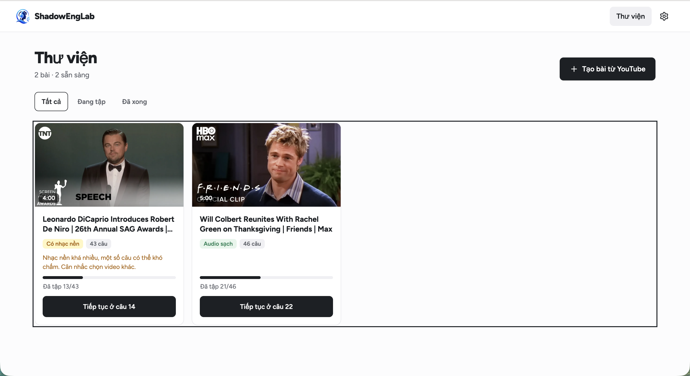
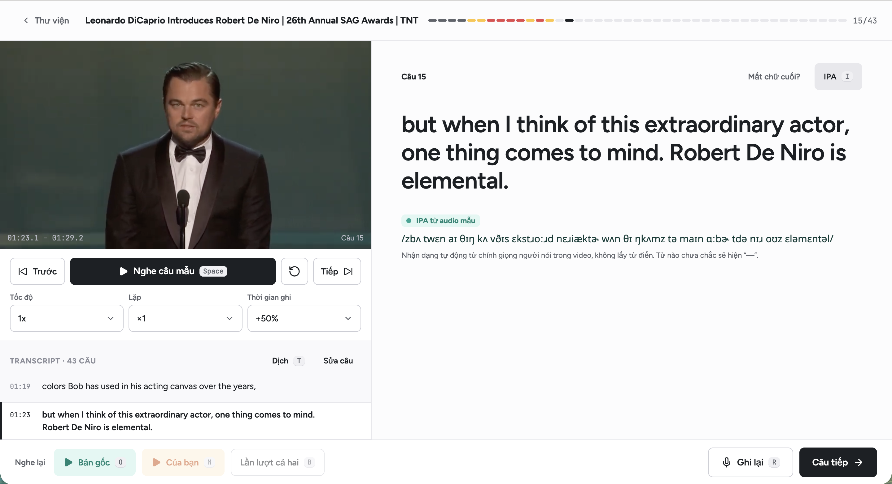

# ShadowEngLab

Web app luyện shadowing tiếng Anh từ bất kỳ video YouTube nào, chạy local. Điểm số so sánh trực tiếp giọng của người học với **audio của chính người nói trong video** (âm, ngữ điệu, trọng âm, ngắt nghỉ), không so với từ điển. Đi kèm một app eval nhỏ để người nghe bản xứ kiểm chứng điểm của hệ thống bằng human review.

> Trạng thái: đã xong 3/8 phase: nền tảng (monorepo, contract, pipeline audio), tạo bài từ YouTube và trình phát theo câu có ghi âm, chấm ngữ điệu (tốc độ, độ lên xuống, khớp giai điệu) kèm gợi ý sửa. Tiếp theo: eval nội bộ để hiệu chỉnh ngưỡng (Phase 4), rồi chấm âm. Build được điều phối bằng [GSD](https://github.com/open-gsd/gsd-core), xem [`docs/gsd/kickoff.md`](docs/gsd/kickoff.md).

## Ảnh chụp

**Thư viện:** dán link YouTube để tạo bài. Mỗi bài có nhãn chất lượng audio (sạch / có nhạc nền), số câu, tiến độ đã tập và nút tiếp tục đúng câu đang dở.



**Phòng tập:** video và transcript theo từng câu, IPA nhận dạng từ chính giọng người nói trong video, nghe mẫu với tốc độ và số lần lặp tuỳ chọn, ghi âm rồi nghe lại bản gốc, bản của bạn hoặc lần lượt cả hai. Thanh trên cùng tô màu từng câu theo điểm tốt nhất.



## Tài liệu

| File | Nội dung |
| --- | --- |
| [`docs/product.md`](docs/product.md) | Product document: phạm vi, hệ thống chấm, app eval, kiến trúc, lộ trình, chi phí |
| [`docs/flows.md`](docs/flows.md) | User flow F0–F5 và bản đồ màn hình |
| [`docs/design/`](docs/design/README.md) | Thiết kế UI v0.2: ảnh và HTML từng màn, token, component |
| [`docs/gsd/`](docs/gsd/) | Roadmap seed P0–P7 và hướng dẫn khởi động GSD |
| [`docs/decisions/`](docs/decisions/) | ADR |
| [`docs/feedback.md`](docs/feedback.md) | Nhật ký dùng thử |
| [`CLAUDE.md`](CLAUDE.md) | Quy tắc làm việc cho Claude Code |

## Cấu trúc

```
apps/web/             Next.js 14 · app chính
apps/eval/            Next.js · app eval (Vercel + Supabase)
services/audio/       FastAPI · pipeline audio và chấm điểm (uv)
packages/contracts/   Zod schema dùng chung
eval/                 export clip, phân tích eval
scripts/              check deps, smoke pipeline, sinh và kiểm tra contract
```

## Bắt đầu

```bash
cp .env.example .env
make setup                      # kiểm tra system deps, cài deps từ lockfile, tải model
                                # nếu dừng vì thiếu deps: chạy các lệnh `brew install …` nó in ra rồi chạy lại
make dev                        # FastAPI 127.0.0.1:8000 + Next.js localhost:3000
make smoke URL=<link youtube>   # tạo bài đầu–cuối bằng script, in thời gian từng bước
```

Yêu cầu: macOS Apple Silicon (mlx-whisper), Node ≥ 22.13, pnpm 11.9, uv, ffmpeg, espeak-ng. `make setup` kiểm tra các mục này nhưng không tự cài.

Không có API key vẫn chạy được (xem `.env.example`).

## Lệnh

| Lệnh | Việc |
| --- | --- |
| `make setup` | Kiểm tra system deps, cài deps Python + Node từ lockfile, tải model (Demucs, mlx-whisper, wav2vec2) |
| `make dev` | Chạy FastAPI và Next.js song song |
| `make test` | Drift gate contract, vitest, pytest |
| `make lint` | eslint, prettier, tsc, ruff |
| `make eval` | Stub ở P0; Phase 4 chạy `eval/analyze.py` |
| `make smoke` | Chạy pipeline tạo bài trên `scripts/smoke_video.url` (hoặc `URL=`; tuỳ chọn `START=`, `END=`, `BUDGET=`) |
| `make contracts` | Sinh lại JSON Schema và pydantic từ Zod |
| `make dev-eval` | Khung app eval (localhost:3001) |
