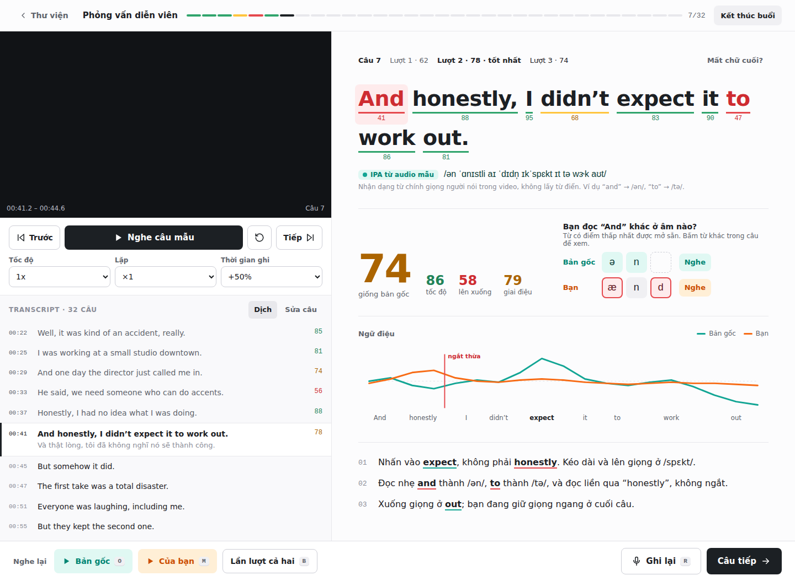

# Thiết kế UI · v0.2 (đã chốt 2026-10-05)

Bản thiết kế là **spec cho Claude Code**: UI phải bám theo các màn dưới đây và `tokens.md`. Thay đổi lớn về UI đi qua canvas thiết kế trước rồi mới sửa code.

- Canvas gốc (sửa và comment tại đây): Claude Design "ShadowEngLab UI"
- Token: [`tokens.md`](tokens.md) (quy tắc) · [`tokens.css`](tokens.css) (giá trị)
- Component: [`components.md`](components.md)
- Luồng người dùng: [`../flows.md`](../flows.md)

## Nguyên tắc

1. Web app: nút bấm là chính, phím tắt là phụ.
2. Hai hệ màu tách biệt: teal / cam = nhận diện **Bản gốc** / **Bạn**; đỏ / vàng / xanh lá = điểm **kém / tạm được / đủ tốt**.
3. Ít card, không shadow, chữ làm phần lớn việc; số liệu quan trọng hiển thị thành số lớn.
4. Chấm theo audio gốc: IPA hiển thị là IPA nhận dạng từ audio mẫu, không phải từ điển.

## Màn hình

Mỗi màn có ảnh (`screens/*.png`) và HTML tĩnh mở được trong trình duyệt (`screens/*.html`). Ảnh render bằng font dự phòng của hệ thống; HTML tải đúng font (Figtree, JetBrains Mono, Noto Sans) khi có mạng.

| Mã | Màn | Flow | File |
| --- | --- | --- | --- |
| — | Design system | — | `00-design-system` |
| S1 | Thư viện | F0, F1, F3, F4 | `S1-thu-vien` |
| S2 | Tạo bài từ YouTube (kèm trạng thái lỗi) | F1 | `S2-tao-bai` |
| S3 + S4 | Phòng tập có kết quả chấm | F2 | `S3-S4-phong-tap` |
| S3 | 6 trạng thái vùng câu hiện tại | F2 | `S3-trang-thai-cau` |
| S5 | Tổng kết buổi | F2 | `S5-tong-ket` |
| S6 | Ôn luyện | F3 | `S6-on-luyen` |
| S7 | Tiến bộ | F4 | `S7-tien-bo` |
| S8 | Settings | F0 | `S8-settings` |
| E1 + E2 | Eval: đăng nhập, hướng dẫn | F5 | `E1-E2-dang-nhap-huong-dan` |
| E3 | Eval: chấm (desktop) | F5 | `E3-cham-desktop` |
| E3 | Eval: chấm (mobile) | F5 | `E3-cham-mobile` |
| E4 | Eval: kết thúc | F5 | `E4-ket-thuc` |

## Ghi chú cho người hiện thực

- Câu, tên video, điểm và số liệu trên các màn là **dữ liệu minh hoạ**; dữ liệu thật đến từ API theo `packages/contracts`.
- Màu điểm luôn đi qua `scoreLevel()`; không hardcode màu theo giá trị trong component.
- Thanh hành động dưới của Phòng tập là `position: sticky`; trong ảnh chụp nó được trải phẳng để thấy hết nội dung.
- Dark mode, mobile cho app chính: ngoài phạm vi Step 1.
