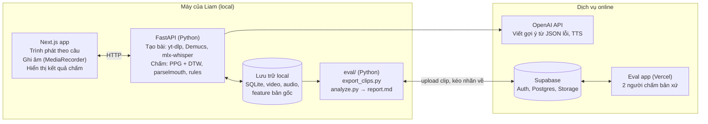
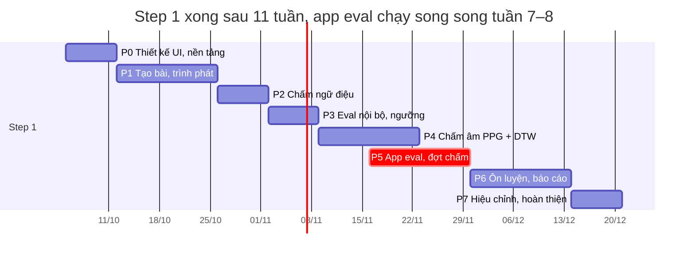

# ShadowEngLab — Product Document

> Nguồn sự thật cấp sản phẩm. Cập nhật: 2026-10-06 · Owner: Liam
> Mọi quyết định thay đổi so với tài liệu này phải được cập nhật tại đây hoặc ghi thành ADR trong `docs/decisions/` ngay trong PR tạo ra thay đổi.

## 1. Tổng quan sản phẩm

ShadowEngLab là web app chạy local giúp luyện shadowing với bất kỳ video YouTube nào, và chấm điểm theo mức độ giống **chính người nói trong video**. Đi kèm là một app eval nhỏ deploy online để 2 người chấm bản xứ đánh giá, dùng để kiểm chứng rằng điểm của hệ thống đáng tin.

### Vision

Dán một link YouTube, tập từng câu, và biết chính xác mình đang nói khác người bản xứ ở đâu: âm nào, trọng âm nào, lên xuống giọng chỗ nào, ngắt nghỉ chỗ nào. Kèm gợi ý cụ thể để sửa.

### Mục tiêu

1. **Học:** Liam dùng app để tự luyện tiếng Anh hằng ngày, khoảng 30 câu mỗi ngày.
2. **Chất lượng chấm:** điểm của hệ thống khớp với cảm nhận của người nghe bản xứ, được đo bằng app eval.

### Người dùng

| Vai trò | Ai | Dùng app nào |
| --- | --- | --- |
| Learner kiêm builder | Liam | App chính (local) |
| Người chấm (rater) | 2 người chấm bản xứ (tiếng Anh Mỹ) | App eval (online) |

### Nguyên tắc sản phẩm

- **So với bản gốc, không so với từ điển.** Đáp án là cách người nói trong video thực sự phát âm. Text chỉ dùng để chia câu, chia từ và hiển thị.
- **Precision trước recall.** Một lỗi báo nhầm gây hại cho người học nhiều hơn một lỗi bị bỏ sót.
- **Local-first, mặc định $0.** Chỉ trả phí khi đem lại giá trị học rõ ràng.
- **Đo được mới tin.** Mọi ngưỡng và mọi con số % phải được hiệu chỉnh bằng dữ liệu eval.
- **Contract-first.** Định nghĩa schema và ranh giới giữa các module trước, rồi giao phần hiện thực cho Claude Code.

### Phạm vi

- **Step 1: App hoàn chỉnh để học (phạm vi của tài liệu này).** Đầy đủ tính năng, không cắt giảm. Điền API key vào `.env`, chạy một lệnh là dùng được hằng ngày.
    - Tạo bài từ link YouTube, trình phát theo câu, ghi âm
    - Chấm đúng từ, chấm âm so với bản gốc, chấm ngữ điệu (biểu đồ, 3 chỉ số, trọng âm, ngắt nghỉ), gợi ý bằng LLM
    - Ôn luyện: lặp lại ngắt quãng các câu yếu, TTS đọc chậm, chế độ chỉ ngữ điệu, dashboard tiến bộ, thư viện video
    - App eval online cho 2 người chấm bản xứ
- **Step 2: Hardening.** Test, CI chạy eval regression, logging và observability, job queue và retry, backup, đóng gói Docker. Làm sau khi Step 1 đã dùng ổn định hằng ngày.
- **Ngoài phạm vi:** nhiều người dùng, thương mại hoá, mobile app, "Nói với AI", chế độ chính tả, luyện giọng UK (Step 1 tập trung giọng US, UK sẽ mở rộng sau).

### Chỉ số thành công

| Chỉ số | Mục tiêu |
| --- | --- |
| Spearman giữa điểm hệ thống và điểm người chấm | Xấp xỉ mức đồng thuận giữa hai người chấm |
| Precision của các cảnh báo lỗi | ≥ 90% |
| Thời gian chấm một câu (local) | ≤ 3 giây |
| Thời gian tạo bài từ video 5 phút | ≤ 5 phút |
| Tần suất tự luyện | ≥ 20 buổi mỗi tháng |

## 2. App chính: Shadowing

App chính gồm 7 module. Toàn bộ UI và trình phát chạy phía client với chi phí $0, còn phần xử lý audio chạy trên một Python service local.

### M0. Cài đặt và cấu hình

- File `.env` chứa `OPENAI_API_KEY` (dùng cho gợi ý và TTS) và `AZURE_SPEECH_KEY` (tuỳ chọn, lớp tham khảo phụ).
- `make setup` cài dependency Python, Node và tải sẵn model (Demucs, mlx-whisper, wav2vec2) có hiển thị tiến độ. `make dev` chạy cả Next.js và FastAPI.
- Trang Settings trong app: kiểm tra key hợp lệ, chọn tốc độ phát mặc định, thời gian ghi âm, thư mục lưu dữ liệu.
- Không có key vẫn chạy được: gợi ý chuyển về template, tắt TTS.

### M1. Tạo bài học từ link YouTube

- Dán link, backend chạy `yt-dlp` để lấy video (360–480p) và audio. Cache theo `videoId`, không xử lý lại video đã có.
- Tách giọng bằng Demucs để có bản vocal sạch, dùng cho phần chấm.
- Transcribe bằng mlx-whisper local để lấy text có dấu câu và word timestamps.
- Tách câu dựa trên word timestamps và khoảng lặng: mỗi câu dài 3–8 giây và tối đa 18 từ. Câu dài hơn khoảng 15 từ thì cắt tại dấu phẩy hoặc khoảng lặng; mảnh ngắn dưới 3 giây thì gộp với câu bên cạnh nếu câu gộp không quá 8 giây và 18 từ (D-21).
- Tính sẵn các feature của bản gốc cho từng câu: F0, năng lượng, prominence theo từ, PPG.
- Cho phép chọn một đoạn của video dài (ví dụ phút 3 đến phút 6).

Ước lượng: 8–12 câu mỗi phút video. Video 3 phút cho khoảng 25–35 câu.

### M2. Trình phát theo câu

- Phát video tự host bằng thẻ `<video>` (file H.264/AAC tải bằng `yt-dlp`, backend phục vụ có hỗ trợ Range để seek). Không dùng YouTube IFrame: bài chỉ mở khi đã sẵn sàng (`video.mp4` đã có); file thiếu hoặc hỏng thì hiện lỗi kèm nút "Tải lại video" (ADR 0004).
- State machine: `idle → playing → recording → reviewing`.
- Điều khiển: câu trước, phát lại, phát, câu sau, tốc độ (0.75x, 1x…), số lần lặp, thời gian ghi âm (+50% độ dài câu).
- Danh sách câu bên phải có highlight câu đang phát. Nút "Sửa" để chỉnh text câu.
- Đệm 100–200ms ở hai đầu câu. Nút "Mất chữ cuối?" để nới thời điểm kết thúc của câu.
- Hiển thị IPA theo cách người nói gốc phát âm (từ phoneme recognizer), có ghi chú đây là kết quả nhận dạng tự động.

### M3. Ghi âm

- `MediaRecorder` phía client. Backend chuẩn hoá về WAV 16kHz mono (Safari ghi `mp4`, Chrome ghi `webm`).
- Tự bắt đầu ghi sau khi câu mẫu phát xong, có countdown. Có nút "Thử lại".
- Không lưu file ghi âm lâu dài. Chỉ giữ features, trừ khi đánh dấu "lưu clip này cho eval".

### M4. Chấm điểm và phản hồi

Kết quả hiển thị cho mỗi câu:

- **Chip từng từ:** xanh là giống bản gốc, vàng là chưa rõ, đỏ là khác. Kèm điểm độ giống.
- **Giải thích âm lệch:** ví dụ "*and*: bản gốc nghe như /ən/, bạn đọc /ænd/".
- **Biểu đồ ngữ điệu:** hai contour F0 (bản gốc và bạn) cùng đường baseline.
- **3 chỉ số:** Tốc độ, Độ lên xuống, Khớp giai điệu (%).
- **Thanh trọng âm theo từ** và dấu ‖ tại chỗ ngắt thừa.
- **2–3 gợi ý cải thiện** viết bằng tiếng Việt.

Chi tiết pipeline ở mục 3.

### M5. Báo cáo luyện tập

- Tổng hợp theo buổi và theo video: điểm trung bình, các loại lỗi hay gặp nhất.
- Danh sách các câu yếu để tập lại.
- Tuỳ chọn đánh dấu clip cho bộ eval.

### M6. Ôn luyện

- **Lặp lại ngắt quãng:** câu có điểm thấp tự quay lại hàng đợi ôn sau 1, 3, 7 ngày.
- **TTS đọc chậm câu khó** (OpenAI `gpt-4o-mini-tts`): nghe bản rõ và chậm trước, rồi quay lại shadow bản gốc.
- **Chế độ chỉ ngữ điệu:** ẩn chữ, chỉ nghe và bắt chước giai điệu.
- **Dashboard tiến bộ theo tuần:** điểm trung bình theo từng chiều (âm, ngữ điệu, nhịp), loại lỗi đang giảm hay tăng.
- **Thư viện video:** các video đã tạo bài, gắn nhãn chất lượng audio, giọng và tốc độ nói, lọc theo nhãn.

## 3. Hệ thống chấm điểm so với bản gốc

Mọi điểm số đều so audio của Liam với audio gốc, không so với từ điển hay "phát âm chuẩn". Hệ thống có 3 lớp độc lập, tất cả chạy local với chi phí $0. Riêng bước viết gợi ý có thể gọi OpenAI.

### Lớp A: Âm (chấm chính bằng PPG + DTW)

1. Cả hai audio (bản gốc đã tách giọng và bản của Liam) đi qua `facebook/wav2vec2-lv-60-espeak-cv-ft` để ra phonetic posteriorgram (PPG): mỗi frame là một phân phối xác suất trên các phoneme, gần như không phụ thuộc giọng người nói.
2. Chạy DTW giữa hai PPG, khoảng cách giữa hai frame là `−log(p_ref · p_user)`.
3. Chiếu ranh giới từ của bản gốc (từ Whisper) sang audio của Liam qua đường DTW.
4. Điểm mỗi từ là trung bình khoảng cách các frame trong từ, có trọng số theo confidence của bản gốc. Từ nào bản gốc có confidence thấp thì gắn nhãn "bản gốc không đủ rõ để chấm".
5. Chuyển sang 0–100% bằng logistic regression fit trên dữ liệu eval.

**Giải thích lỗi:** chỉ với những từ lệch nhiều, lấy âm có xác suất cao nhất ở mỗi frame (argmax) của cả hai bên, gộp thành chuỗi phone, rồi hiển thị kiểu "bản gốc /ən/, bạn /ænd/".

### Lớp B: Ngữ điệu và nhịp điệu (parselmouth)

1. Trích F0 khoảng mỗi 10ms, chỉ giữ frame hữu thanh. Lọc lỗi quãng tám và giới hạn khoảng pitch theo từng người.
2. Đổi sang semitone so với median pitch của từng người, sau đó nội suy và làm mượt.
3. Căn thời gian theo ranh giới từ và resample contour của từng từ.
4. Tính các chỉ số:

| Chỉ số | Công thức |
| --- | --- |
| Tốc độ | `r = dur_user / dur_ref` (chỉ tính thời gian có tiếng), `score = min(r, 1/r)` |
| Độ lên xuống | Tỉ lệ độ lệch chuẩn của contour semitone, rồi `min(r, 1/r)` |
| Khớp giai điệu | Pearson correlation của hai contour đã căn, map sang 0–100% |
| Prominence của từ | `0.4·z(F0_max) + 0.4·z(intensity_max) + 0.2·z(duration)` |

### Lớp C: Rule engine và gợi ý

| Mã lỗi | Điều kiện (ngưỡng ban đầu, sẽ hiệu chỉnh qua eval) | Ví dụ gợi ý |
| --- | --- | --- |
| `STRESS_MISMATCH` | Từ có prominence cao nhất khác nhau giữa hai bên | Nhấn mạnh *Brown*, không phải *Heat* |
| `EXTRA_PAUSE` | Khoảng lặng của Liam > 250ms, của bản gốc < 100ms | Đừng ngắt sau *Jackie* |
| `FINAL_CONTOUR` | Độ dốc F0 ở 300ms cuối ngược dấu nhau | Cuối câu cần xuống giọng |
| `FLAT_PITCH` | Độ lên xuống < 60% | Giọng hơi phẳng, lên xuống rõ hơn |
| `PITCH_DEVIATION` | Chênh trung bình > 2–3 semitone trên một từ | Lên giọng ở *Brown* |
| `PHONE` | Điểm âm của từ dưới ngưỡng | *and*: bản gốc /ən/, bạn /ænd/ |
| `WORD_MISSING` | Từ của bản gốc không có đoạn tương ứng trong audio của Liam | Bạn bỏ sót từ *exactly* |

Gợi ý có 2 mức: template ($0, làm trước), sau đó nâng lên LLM của OpenAI (model nhỏ, structured output). LLM chỉ nhận JSON lỗi, không nhận audio, nên mỗi gợi ý phải trỏ được tới một mục trong `issues`.

### Contract kết quả chấm

```ts
// JSON qua ranh giới là camelCase. Điểm là float 0..1; mốc thời gian là giây, độ dài ngắt nghỉ là ms nguyên.
type ScoreResult = {
  lessonId: string; segmentIndex: number; attempt: number            // attempt >= 1
  mode: "full" | "intonationOnly"
  versions: { scorer: string; thresholds: string }
  timingMs: Record<string, number>                                   // thời gian từng bước, kiểm ngân sách <= 3 s
  scores: {
    overall: number
    sound: number | null                                             // null ở P2–P3 hoặc khi cả câu ref_unclear
    intonation: number; rhythm: number
  }
  words: { text: string; status: "scored" | "missing" | "ref_unclear"
           similarity: number                                        // màu chip suy từ đây qua scoreLevel()
           start: number; end: number                                // giây, trên audio người học
           refPhones?: string; userPhones?: string }[]
  prosody: {
    speed: number; pitchRange: number; melodyMatch: number           // 0..1
    contour: { ref: (number | null)[]; user: (number | null)[]       // semitone, đã căn; null = frame không hữu thanh
               wordBounds: number[] }                                // chỉ số trên trục contour nơi mỗi từ bắt đầu
    stress: { word: string; ref: number; user: number }[]
    pauses: { afterWord: number; refMs: number; userMs: number }[]
  }
  issues: Issue[]                                                    // union theo `code`, mỗi mã có `data` riêng (bên dưới)
  tips: { text: string; issueRef: number                             // issueRef là chỉ số trong issues
          source: "template" | "llm" }[]                             // UI chỉ hiện nhãn "AI" khi source = "llm"
}

type Issue =
  | { code: "STRESS_MISMATCH"; wordIndex: number; data: { refWord: string; userWord: string } }
  | { code: "EXTRA_PAUSE";     wordIndex: number; data: { refMs: number; userMs: number } }
  | { code: "FINAL_CONTOUR";                      data: { refSlope: number; userSlope: number } }
  | { code: "FLAT_PITCH";                         data: { pitchRange: number } }
  | { code: "PITCH_DEVIATION"; wordIndex: number; data: { meanDiffSt: number } }
  | { code: "PHONE";           wordIndex: number; data: { refPhones: string; userPhones: string; similarity: number } }
  | { code: "WORD_MISSING";    wordIndex: number; data: {} }
```

Nguồn sự thật: `packages/contracts` (Zod, file `src/score.ts`); khối này chỉ tóm tắt. `wordIndex` là chỉ số trong `words`. `IssueCode` là enum 7 mã ở trên, được export riêng.

### Giới hạn đã biết

- Chất lượng audio gốc quyết định giới hạn trên của hệ thống. Nên ưu tiên video phỏng vấn sạch.
- Hệ thống yêu cầu bắt chước cả những chỗ người nói gốc nói lướt. Với shadowing, đây là hành vi mong muốn.
- Hệ thống đo được sự khác biệt nhưng không biết ý đồ của người nói (ví dụ vì sao nhấn từ đó).

## 4. App Evaluation

App eval là một web app nhỏ deploy online để 2 người chấm bản xứ đánh giá khoảng 68 clip, mỗi người mất khoảng 45 phút. Kết quả dùng để hiệu chỉnh ngưỡng và kiểm chứng điểm của app chính.

### Vì sao cần

- Khoảng cách DTW hay số semitone thô không có ý nghĩa nếu chưa hiệu chỉnh. Cùng một cách đọc, audio sạch và audio nhiễu sẽ cho con số khác nhau.
- Tai của Liam chưa đủ tin cậy để gán nhãn, vì người học chưa tự nghe ra hết lỗi của mình.
- Lỗi cố ý thường rõ ràng và mỗi bản ghi chỉ có một lỗi. Lỗi thật thì tinh tế và nhiều lỗi lẫn nhau. Cần bộ lượt luyện tự nhiên do người bản xứ chấm để kiểm chứng.

### Bộ dữ liệu eval (3 tầng)

| Tầng | Nội dung | Số lượng | Ai gán nhãn |
| --- | --- | --- | --- |
| Mốc đúng | Audio gốc so với chính nó. Người khác đọc đúng câu | ~8 | Có sẵn |
| Lỗi cố ý | Mỗi bản ghi mắc 1 lỗi: weak form, nuốt âm cuối, nhấn sai, đọc đều, ngắt thừa, lên giọng cuối câu | ~100 | Liam, vì biết chắc lỗi nằm ở đâu |
| Lượt luyện tự nhiên | Shadow bình thường, phân tầng theo điểm hệ thống (cao, trung bình, thấp), trải trên 3–4 video giọng Mỹ | ~60 | 2 người chấm bản xứ qua app eval |

Tách 30% làm held-out, không dùng khi chỉnh ngưỡng.

### Chức năng

1. **Đăng nhập:** magic link Supabase, chỉ 2 email trong allowlist.
2. **Trang hướng dẫn** (tiếng Anh, bắt buộc đọc trước): chấm theo độ giống *người nói này*, không chấm theo "đúng chuẩn". Có 3 ví dụ mẫu cho mức 5, 3, 1 và giải thích 5 loại cờ.
3. **Màn hình chấm:** nút phát audio gốc, phát audio learner, phát lần lượt cả hai. Click vào từ để gắn cờ (sound, stress, pitch, pause, speed). Chấm điểm 1–5. Chọn cuối câu có khớp hay không. Ô "không chắc chắn" và ghi chú tự do.
4. **Phím tắt:** `O`, `L`, `Space`, `1–5`, `Enter`.
5. Chưa nghe đủ cả hai file thì không bấm được Next. Tự lưu khi chuyển clip, có thể dừng và làm tiếp sau.
6. Thứ tự clip xáo trộn riêng cho mỗi người. 8 gold clips nằm lẫn trong đó. Hai người không thấy nhãn của nhau.
7. Responsive trên mobile. Audio phát qua signed URL có hạn khoảng 1 giờ.

### Data model

```sql
clips  (id text pk, video_id, sentence_text, words jsonb,
        ref_path, user_path, gold text, system_score real)
labels (id uuid pk, clip_id fk, rater_id uuid fk auth.users,
        overall int, word_flags jsonb, final_contour_match bool,
        unsure bool, note text, duration_ms int, created_at,
        unique (clip_id, rater_id))
```

RLS: người chấm chỉ đọc và ghi nhãn của chính mình. Hai cột `gold` và `system_score` không bao giờ được trả về client. Audio nằm trong bucket private.

### Contract giữa hai app

`manifest.json` do app chính export:

```ts
const ClipManifest = z.object({
  clipId: z.string(), videoId: z.string(), sentenceText: z.string(),
  words: z.array(z.object({ i: z.number().int().min(0), text: z.string() })),
  refAudio: z.string(), userAudio: z.string(),
  gold: z.enum(["none", "identical", "wrong"]).default("none"),
  systemScore: z.number().min(0).max(1).optional()
})
```

Nhãn của người chấm (`Label`) dùng chung một contract giữa app eval và `eval/analyze.py`:

```ts
const Label = z.object({
  clipId: z.string(), raterId: z.string(),
  overall: z.union([z.literal(1), z.literal(2), z.literal(3), z.literal(4), z.literal(5)]),
  wordFlags: z.array(z.object({                          // chỉ lưu từ có cờ
    wordIndex: z.number().int().min(0),                  // khớp ClipManifest.words[].i
    flags: z.array(z.enum(["sound", "stress", "pitch", "pause", "speed"]))
  })),
  finalContourMatch: z.boolean(), unsure: z.boolean(), note: z.string().optional(),
  durationMs: z.number().int().min(0), createdAt: z.string()
})
```

Nguồn sự thật: `packages/contracts` (Zod, file `src/eval.ts`); các khối trên chỉ tóm tắt. JSON giữa các app là camelCase, còn bảng SQL `clips` và `labels` ở trên vẫn snake_case (ví dụ `word_flags jsonb`, `final_contour_match`); việc map nằm ở app eval và lớp export.

Script export: cắt khoảng lặng ở hai đầu, chuẩn hoá âm lượng (`ffmpeg loudnorm`), xuất opus hoặc mp3 ~64kbps. Audio gốc dùng bản như trong video, không dùng bản đã tách giọng.

### Phân tích (`eval/analyze.py`, chạy local)

| Metric | Câu hỏi |
| --- | --- |
| Gold check, thời gian chấm < 8 giây | Nhãn nào không đáng tin? |
| Spearman, Cohen's kappa giữa hai người chấm | Câu hỏi chấm có đủ rõ không? |
| Spearman giữa hệ thống và người chấm | Điểm có phản ánh cảm nhận người nghe không? |
| Precision và recall trên từ bị gắn cờ, theo từng loại | Có báo đúng chỗ không, loại lỗi nào hay bị bỏ sót? |
| Calibration curve | "81%" có nghĩa là 81% không? |
| Test-retest, speaker invariance | Điểm có ổn định, có bị ảnh hưởng bởi giọng không? |
| Trung thực của gợi ý | LLM có bịa ra lỗi không? |

Kết quả xuất ra `report.md`. Bộ clip và nhãn được giữ cố định làm regression suite: mỗi lần đổi model hay ngưỡng thì chạy lại, không cần nhờ chấm lại.

## 5. Kiến trúc kỹ thuật và tech stack

Toàn bộ xử lý audio và chấm điểm chạy trên máy của Liam. Chỉ có 2 thứ đi ra ngoài: JSON lỗi gửi OpenAI để viết gợi ý, và clip eval đẩy lên Supabase cho người chấm.



FastAPI là lõi của hệ thống: nó tạo bài học, tính sẵn feature của bản gốc và chấm mỗi lượt ghi âm. Thư mục `eval/` là cầu nối duy nhất giữa app chính và app eval.

### Tech stack

| Tầng | Công nghệ |
| --- | --- |
| Frontend app chính | Next.js 14, TypeScript, Tailwind + shadcn/ui (token Radix Colors, xem `docs/design/tokens.md`), TanStack Query, Recharts, XState |
| Backend audio | Python 3.11 (quản lý bằng uv), FastAPI, yt-dlp, ffmpeg, Demucs, mlx-whisper, transformers (wav2vec2-espeak), parselmouth, numpy, espeak-ng |
| Lưu trữ local | SQLite và file system |
| LLM | OpenAI (model nhỏ, structured output), TTS `gpt-4o-mini-tts` |
| App eval | Next.js trên Vercel, Supabase (Auth magic link, Postgres + RLS, Storage private), Zod |
| Phân tích eval | Python, pandas, scipy (Spearman), scikit-learn (Cohen's kappa, logistic regression) |

### Cấu trúc repo

```
shadowenglab/
  CLAUDE.md
  docs/
    product.md          # tài liệu này
    decisions/          # ADR
    gsd/                # roadmap-seed.md, kickoff.md (kế hoạch và state do GSD quản lý)
    design/             # export từ Claude Design
  apps/web/             # Next.js app chính
  apps/eval/            # Next.js app eval
  services/audio/       # FastAPI: lesson, scoring, rules
  packages/contracts/   # Zod schema dùng chung: Segment, Lesson, ScoreResult, IssueCode, ClipManifest, Label
  eval/                 # clips, labels.jsonl, export_clips.py, analyze.py
```

## 6. Kế hoạch implement

Step 1 (app đầy đủ tính năng để học) mất khoảng 11 tuần làm solo cùng Claude Code. Step 2 (hardening) thêm khoảng 3–4 tuần. Thứ tự đi từ phần dễ và tạo giá trị học sớm (trình phát, ngữ điệu) đến phần khó (chấm âm). Ngưỡng luôn được hiệu chỉnh ngay sau khi mỗi lớp chấm chạy được.



Ngày bắt đầu trong biểu đồ chỉ mang tính minh hoạ. App eval (P5) được build song song với P4, để đợt chấm của 2 người diễn ra trong lúc Liam hoàn thiện lớp chấm âm.

### Thiết kế UI trước khi code (P0)

Toàn bộ màn hình của cả hai app được thiết kế bằng Claude Design trước, sau đó dùng bản thiết kế làm spec giao cho Claude Code.

| App | Màn hình cần thiết kế |
| --- | --- |
| App chính | Thư viện video và tạo bài từ link. Trình phát theo câu kèm danh sách câu. Panel kết quả chấm (chip từng từ, biểu đồ ngữ điệu, 3 chỉ số, thanh trọng âm, gợi ý). Ôn luyện và dashboard tiến bộ. Settings |
| App eval | Đăng nhập. Hướng dẫn chấm. Màn hình chấm. Màn hình kết thúc |

- Bắt đầu bằng một design system dùng chung cho cả hai app (màu, typography, spacing, component), map sang Tailwind + shadcn/ui.
- Thiết kế đủ các trạng thái: đang tạo bài, đang ghi âm, đang chấm, lỗi, chưa có API key, audio gốc không đủ rõ để chấm.
- Chốt thiết kế trước khi bắt đầu P1. Thay đổi lớn về UI sau đó cũng đi qua Claude Design trước rồi mới sửa code.

### Chi tiết từng phase

| Phase | Việc chính | Tiêu chí hoàn thành |
| --- | --- | --- |
| P0 · Thiết kế UI, nền tảng (tuần 1) | Thiết kế UI bằng Claude Design, monorepo, `packages/contracts` (Zod: `Segment`, `ScoreResult`, `ClipManifest`, `Label`), skeleton FastAPI, cài Demucs, mlx-whisper, wav2vec2, parselmouth | Thiết kế UI được chốt. Chạy được một video mẫu từ đầu đến cuối bằng script |
| P1 · Tạo bài, trình phát (tuần 2–3) | M0 cài đặt và Settings, M1 tạo bài và tách câu, M2 trình phát với state machine, M3 ghi âm, IPA theo bản gốc | Tạo bài video 5 phút ≤ 5 phút. Tập được trọn một video không lỗi |
| P2 · Chấm ngữ điệu (tuần 4) | Lớp B, rule engine (template), biểu đồ contour, 3 chỉ số, thanh trọng âm | Kiểm tra cơ bản: bản gốc so với chính nó ≈ 100%. Câu sai hẳn cho điểm thấp |
| P3 · Eval nội bộ (tuần 5) | Thu ~100 clip lỗi cố ý, `analyze.py` bản đầu, chỉnh ngưỡng các rule ngữ điệu | Precision các rule ngữ điệu ≥ 90% trên tập held-out |
| P4 · Chấm âm (tuần 6–7) | Lớp A: PPG + DTW, chiếu ranh giới từ, trọng số confidence, giải thích bằng chuỗi phone, chip từng từ | Chấm một câu ≤ 3 giây. Bắt được các lỗi weak form và nuốt âm trong bộ lỗi cố ý |
| P5 · App eval (tuần 7–8) | Build app eval (~4 ngày), export 60 clip tự nhiên + 8 gold, pilot 5 clip với 1 người chấm, sau đó cả hai người chấm toàn bộ | 2 người chấm xong, kappa giữa hai người ≥ 0.4 |
| P6 · Ôn luyện (tuần 9–10) | M5 báo cáo, M6: lặp lại ngắt quãng, TTS đọc chậm, chế độ chỉ ngữ điệu, dashboard tiến bộ, thư viện video | Tự luyện trọn một tuần chỉ bằng app, không cần công cụ nào khác |
| P7 · Hiệu chỉnh, hoàn thiện (tuần 11) | Fit logistic cho điểm %, chỉnh ngưỡng theo nhãn người chấm, gợi ý bằng LLM, sửa lỗi UX tích luỹ, `report.md` và README | Spearman hệ thống và người chấm xấp xỉ mức đồng thuận giữa hai người chấm. Máy mới: clone, điền `.env`, `make setup && make dev` là dùng được |

### Cách làm việc với Claude Code và GSD

- Việc build được điều phối bằng GSD (`docs/decisions/0002-dung-gsd.md`). Mỗi phase bắt đầu bằng bước Discuss: Liam chốt contract trong `packages/contracts` và các quyết định còn mở.
- Giao Claude Code hiện thực theo spec. Liam review tại ranh giới: schema, state machine, output của pipeline.
- Mọi thay đổi về model hoặc ngưỡng từ P3 trở đi phải chạy lại `analyze.py` trước khi merge.

### Step 2: Hardening

Bắt đầu khi Step 1 đã được dùng ổn định hằng ngày khoảng 2 tuần, để biết chỗ nào thực sự hay hỏng. Ước lượng 3–4 tuần.

- [ ] Test: unit cho rule engine và các metric, integration cho pipeline tạo bài và chấm
- [ ] CI chạy `analyze.py`, fail nếu Spearman hoặc precision giảm
- [ ] Logging có cấu trúc và trace cho từng lượt chấm (thời gian từng bước, lỗi)
- [ ] Job queue cho việc tạo bài, retry khi yt-dlp hoặc model lỗi, cho phép huỷ job
- [ ] Migration cho SQLite, backup dữ liệu học tập
- [ ] Đóng gói Docker hoặc script cài đặt một lệnh
- [ ] Bảo mật app eval: rate limit, rà lại RLS, xoá audio sau mỗi đợt eval

## 7. Chi phí

App chạy với khoảng **$0–1 mỗi tháng**. Khoản chi thực sự duy nhất là OpenAI cho phần viết gợi ý và TTS (tuỳ chọn), còn eval dùng human review. Giả định Liam tập khoảng 30 câu mỗi ngày, tức ~900 câu và ~75 phút audio mỗi tháng.

### Chi phí vận hành hằng tháng

| Hạng mục | Giải pháp | Chi phí/tháng |
| --- | --- | --- |
| Tải video, tách giọng, transcribe | yt-dlp, Demucs, mlx-whisper (local) | $0 |
| Chấm âm, ngữ điệu, rule engine | wav2vec2, parselmouth (local) | $0 |
| Gợi ý bằng LLM | OpenAI model nhỏ, ~900 lượt | < $1 |
| TTS đọc chậm câu khó | OpenAI `gpt-4o-mini-tts` | vài cent |
| Hosting app eval | Vercel Hobby + Supabase free tier | $0 |
| **Tổng** | | **~$0–1** |

### Chi phí cho mỗi đợt eval

| Hạng mục | Chi phí |
| --- | --- |
| Human review | $0 |

### Phương án trả phí tuỳ chọn

| Dịch vụ | Dùng cho | Đơn giá | Ước tính/tháng |
| --- | --- | --- | --- |
| Azure Pronunciation Assessment | Kiểm tra "đúng chuẩn" (so với text) làm lớp tham khảo phụ | ~$1.30/giờ audio | ~$1.6 |
| SpeechSuper | Chấm chi tiết, có nối âm, chọn giọng UK/US | $0.006/câu, tối thiểu $20/tháng | $20 |
| OpenAI `whisper-1` thay mlx-whisper | Khi không muốn chạy model local | $0.006/phút | ~$0.5 |

Giá niêm yết lấy từ trang giá của các nhà cung cấp tại thời điểm tháng 9/2026. Cần kiểm tra lại trước khi đăng ký.

### Chi phí thời gian

Step 1 khoảng 11 tuần làm solo cùng Claude Code, Step 2 thêm 3–4 tuần (chi tiết ở mục 6). Phần tốn thời gian nhất là tinh chỉnh pipeline audio và hiệu chỉnh ngưỡng, không phải UI.

## 8. Quyết định đã chốt và rủi ro

### Quyết định đã chốt

| Quyết định | Lý do |
| --- | --- |
| Dự án cá nhân, không thương mại hoá, chạy local | Học cá nhân. Cho phép lấy toàn bộ nguồn từ YouTube |
| Chấm hoàn toàn theo audio gốc, bỏ từ điển | Mục tiêu là bắt chước chính người nói, kể cả weak form và nuốt âm |
| PPG + DTW là bộ chấm âm chính. Chuỗi phone chỉ để giải thích | So phân phối xác suất thì dễ dãi ở những chỗ bản gốc mơ hồ, không cần đáp án cứng |
| Tự host video (không dùng IFrame, ADR 0004) | Seek chính xác, không quảng cáo, dùng chung file nguồn với pipeline chấm |
| Không dùng model audio của LLM để chấm điểm | Không nhất quán, hay bịa lỗi |
| LLM chỉ viết gợi ý từ JSON lỗi | Gợi ý luôn bám sát số liệu đo được |
| App eval: 2 người chấm toàn bộ, không đồng bộ | Có số liệu đồng thuận trên mọi clip, không cần chia phần |
| Giọng mục tiêu US cho Step 1, người chấm nói tiếng Anh Mỹ | Chọn video, bộ eval và ngưỡng theo giọng Mỹ. UK mở rộng sau |
| Step 1 chỉ giữ features, không lưu lịch sử ghi âm | Lưu lịch sử ghi âm để nghe lại tiến bộ là bản nâng cấp sau |
| Public trên GitHub | README chỉ ghi chung là có human review và chấm thực tế. Audio eval và nhãn thô giữ ngoài repo |
| Thiết kế UI bằng Claude Design trước khi code | Bản thiết kế là spec giao cho Claude Code |
| UI v0.2: Radix Colors, nút là chính, hai hệ màu tách biệt (nguồn / điểm) | Xem `docs/design/README.md` |
| Điều phối build bằng GSD (gsd-core) | Xem `docs/decisions/0002-dung-gsd.md` |
| Python dùng uv, trình phát dùng XState | Xem `docs/decisions/0001-uv-va-xstate.md` |

### Rủi ro

| Rủi ro | Mức độ | Cách giảm thiểu |
| --- | --- | --- |
| Audio gốc có nhạc nền, tiếng vỗ tay làm sai F0 và PPG | Cao | Demucs bắt buộc. Gắn nhãn "không đủ rõ" theo confidence. Ưu tiên video sạch |
| Ngưỡng chỉnh theo lỗi cố ý bỏ sót lỗi tinh tế | Cao | Bộ lượt luyện tự nhiên do người bản xứ chấm. Tập held-out |
| Hai người chấm đồng thuận thấp (kappa < 0.4) | Trung bình | Pilot 5 clip trước. Viết lại hướng dẫn và ví dụ mẫu |
| Phoneme recognizer nhận sai trên bản gốc | Trung bình | So xác suất thay vì phone cứng. Trọng số theo confidence |
| Lỗi quãng tám của F0 tạo gai giả | Trung bình | Giới hạn khoảng pitch theo người, lọc bước nhảy đột ngột |
| yt-dlp hỏng khi YouTube thay đổi | Thấp (chạy local) | Cập nhật yt-dlp định kỳ. Cache video đã tải |
| Timestamp Whisper cắt mất âm đầu hoặc cuối câu | Thấp | Đệm 100–200ms, nút "Mất chữ cuối?" |
| Độ trễ chấm vượt 3 giây | Thấp | Tính sẵn toàn bộ feature của bản gốc khi tạo bài |

## 9. Action improve (sau Step 1 và Step 2)

Xếp theo giá trị học. Chỉ làm khi eval cho thấy phần lõi đã đáng tin.

### Cải thiện chất lượng chấm

- [ ] Thử WavLM (layer 6–9) so với PPG trên bộ eval. Chỉ giữ cái có Spearman cao hơn
- [ ] Hiệu chỉnh ngưỡng theo mức nhiễu của từng video, thay vì một ngưỡng chung
- [ ] Thêm phát hiện nối âm (linking) và nhịp (tỉ lệ độ dài âm tiết, nPVI)
- [ ] Kiểm tra speaker invariance định kỳ: nhờ một người khác giới đọc đúng, điểm phải vẫn cao
- [ ] Gợi ý kèm mẹo khẩu hình cho các âm Liam hay sai nhất (LLM có ngữ cảnh lịch sử lỗi)

### Cải thiện trải nghiệm học

- [ ] Tự đề xuất video theo loại lỗi hay gặp (ví dụ nhiều lỗi weak form → video có tốc độ nói nhanh)
- [ ] Shadowing cả đoạn dài sau khi đã thuần từng câu
- [ ] Bản nâng cấp: lưu lịch sử ghi âm, nghe lại bản cũ và bản mới của cùng một câu để thấy tiến bộ

### Mở rộng sản phẩm (xa hơn)

- [ ] "Nói với AI" về nội dung video (OpenAI Realtime API)
- [ ] Chế độ chính tả (nghe và gõ lại)
- [ ] Mở rộng sang giọng UK (đã định hướng): kiểm tra lại pipeline, bổ sung bộ eval và hiệu chỉnh lại ngưỡng với video giọng Anh
- [ ] Deploy cho người khác dùng. Khi đó cần xem lại vấn đề pháp lý của việc tải từ YouTube và chi phí GPU

### Cải thiện eval

- [ ] Thêm dạng so sánh cặp A/B trong app eval để đo thứ hạng
- [ ] Mở rộng bộ lượt luyện tự nhiên sau mỗi 2–3 tháng luyện tập
- [ ] Đợt chấm thứ hai sau mỗi thay đổi lớn về model

## Nguồn tham khảo giá

- [Azure Speech: giá real-time và add-on pronunciation assessment](https://blocksentient.com/review/microsoft-azure-speech-service/)
- [Azure: pronunciation assessment không hỗ trợ Fast Transcription](https://learn.microsoft.com/en-us/answers/questions/5575747/how-to-use-the-azure-speech-to-text-fast-transcrip)
- [Azure: prosody assessment chỉ hỗ trợ en-US](https://learn.microsoft.com/en-us/azure/ai-services/speech-service/how-to-pronunciation-assessment)
- [SpeechSuper: bảng giá API](https://www.speechsuper.com/pricing.html)
- [OpenAI: giá các model transcription](https://costgoat.com/pricing/openai-transcription)
